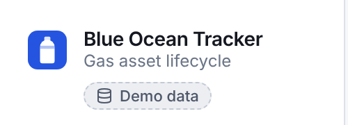
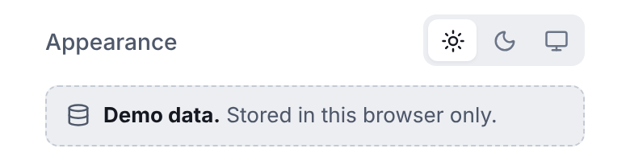

# Blue Ocean Tracker (brief version)

A web app that tracks gas cylinders through their lifecycle: filling, delivery, return, maintenance and retirement.

This is the **brief version**: it does what the requirement asks for, plus a few design decisions I kept on purpose (listed in section 2). The full version, with Analytics, Status rules, cylinder history and the lifecycle diagram, lives in `frontend/` and `backend/` next to this folder.

| Folder | What it is |
| --- | --- |
| `frontend-brief/` | React + TypeScript app. Includes the design library at `/design-system`. This README. |
| `backend-brief/` | ASP.NET Core 8 Web API with EF Core and SQLite, seeded from `cylinders.json`, plus xUnit integration tests. |

Screens are in [`docs/screenshots`](docs/screenshots). Test results: [`docs/test-results/frontend-tests.png`](docs/test-results/frontend-tests.png) (42 Vitest tests) and [`../backend-brief/docs/test-results/backend-tests.png`](../backend-brief/docs/test-results/backend-tests.png) (25 xUnit tests).

## 1. Setup and running

Requirements: Node 20 or newer.

```bash
cd frontend-brief
npm install
npm run dev        # http://localhost:5173
npm test           # frontend tests (Vitest + Testing Library)
npm run build      # production build in frontend-brief/dist
```

By default the app runs against an **in-browser mock API** (Mock Service Worker). It's seeded from `cylinders.json` and saves changes to `localStorage`, so no server is needed and the build can be hosted as a static site.

**How to tell you're on the mock API:** when the frontend runs without `VITE_API_URL`, the app shows a **"Demo data"** badge under the app name in the sidebar. On phones, the same note sits at the bottom of the menu. It means every change is saved in this browser only: another browser or device won't see it, and clearing site data or "Reset data to the JSON seed" in the Miscellaneous panel brings back the original 87 cylinders. When the app runs against the .NET API, the badge disappears.

<p>
  
  &nbsp;
  
</p>

### Backend

Requirements: .NET 8 SDK.

```bash
cd backend-brief
dotnet test                                   # 25 integration tests (xUnit + WebApplicationFactory)
cd Cylinders.Api
dotnet run --urls http://localhost:5080       # creates cylinders.db and seeds the 87 records on first run
```

Swagger UI: http://localhost:5080/swagger. To reseed, stop the API and delete `cylinders.db`.

To point the frontend at the API, run this in another terminal:

```bash
cd frontend-brief
VITE_API_URL=http://localhost:5080 npm run dev
```

CORS allows `http://localhost:5173` and `http://localhost:4173` by default (`Cors:Origins` in `appsettings.json`, or `CORS_ORIGINS` for hosted frontends).

## 2. Changes from the brief

The API and the rules follow the brief exactly. These are the differences, and the extras I kept as design decisions.

**Data and API**

- **Ids 1–87 are assigned in file order.** The brief says the JSON has ids, but `cylinders.json` has none.
- **Stricter input checks.** An unknown status filter or a `pageSize` below 1 returns 400 instead of being ignored, so a bad link shows an error rather than a silently wrong list.
- **The frontend runs on its own mock API by default.** The mock follows the same contract as the .NET API, and setting `VITE_API_URL` at build time switches to it.

**Kept on purpose, not in the brief**

- **A sidebar with page navigation, and a top bar with a drop-down menu on phones.** This version has one product page, Cylinders, but the app is built to grow (the full version adds Analytics and Status rules), so the navigation frame is already in place.
- **A cylinder detail page,** trimmed to the brief's fields: Record ID, serial number, gas type, customer and last updated, plus "Edit details" and a "Move to" bar with only the allowed moves.
- **A ⋯ action menu on phone cards,** with Detail, Edit details and Change status in 44px rows.
- **A page change lands on the top of the list** on phones, so the next page isn't loaded out of sight.
- **List state lives in the URL** (`?q=&status=&page=&pageSize=`), so a filtered view survives a reload and can be shared.
- **Toasts pause on hover, and drop in under the top bar on phones.**
- **Returning a cylinder to Empty says which customer it clears,** so ops can check it's the right company first.
- **A "Miscellaneous" panel** holds the design system link, the light/dark/system theme and, in mock mode, demo controls for network delay, forced failures and a data reset, so reviewers can see the loading and error states.
- **The design system page** is the design library the role asks for.

## 3. Key design decisions

- **The design library lives in code, as a living style guide.** Tokens are CSS custom properties in three tiers: primitives, semantic roles and component use (`src/styles/tokens.css`). Components in `src/ds/` use only semantic tokens, which is how dark mode works: it swaps one layer. `/design-system` renders the real components, so the docs can't drift from the product.
- **One colour, dot and label per status, everywhere.** Status is what people scan for, so it reads the same in badges, filter pills and the status dialog.
- **Gas colours follow ISO 32,** so the screen matches the paint on the physical cylinder.
- **Prevent, then explain.** The UI only offers moves the lifecycle allows (Change status is off for Retired), checks input with the same rules as the API, asks for a review before saving, and if the server still says no, shows its reason in a pop-up and on the matching field.
- **The list fills the screen.** Search, filters, column names and pagination stay pinned and only the rows scroll. The footer shows even at 0 results, so the layout doesn't jump.
- **The customer lives in the Status cell: [status] With <customer>.** A cylinder only has a customer while it's Delivered, so a Customer column would be mostly dashes.
- **Row actions:** Edit details and Change status as quiet buttons, Detail as a soft blue tint. Rows aren't clickable, so a stray click while selecting a serial never navigates away. Labels show when the list is wide enough and all become icons together when it isn't.
- **Create and edit go through a review step** that shows old → new before saving; this is the brief's "validation window". The serial field has a fixed `CYL-` prefix, accepts digits only and normalises pasted text such as ` cyl-012345 `.
- **The status dialog** shows the move as a preview row, then the allowed next statuses as cards with a "Usual next step" tag and nothing pre-selected. Delivered asks for the customer (max 120 characters). The choices lock while saving, and a double Enter sends one request.
- **Every data screen has loading, empty and error states.** Skeleton rows while loading, the previous page kept with a thin progress bar while paging, specific empty states (no results, a page past the end, no data), and errors with a retry, separate for offline and server errors. A slow first load says the free host may be waking up.
- **Messy data.** Long names truncate with the full name on hover, serials use a monospaced font so look-alikes are easy to tell apart, and search ignores case, accents included (`östara` finds "Östara").
- **Accessibility.** Native `<dialog>` for focus trapping and `Esc`, labelled fields with hints and errors linked by `aria-describedby`, radio-group semantics for filters, a skip link and visible focus rings.

### Engineering

- **Frontend stack:** React 19, TypeScript, Vite, React Router, TanStack Query, MSW and lucide icons. Plain CSS with tokens, no UI kit.
- **One rules file with a C# twin.** The lifecycle and validation rules live in `src/lib/domain.ts` and are mirrored in `backend-brief/Cylinders.Api/Domain/CylinderRules.cs`.
- **The mock API is a real implementation** of the brief's contract: same routes, status codes and RFC 7807 problem bodies as the .NET API.
- **Backend:** minimal API endpoints on exactly the five recommended routes. Errors are RFC 7807 problem details with a field-keyed `errors` object. Serials are stored in upper case under a unique index; the API checks for a clash first to return 409, and the index turns a racing duplicate into the same 409, never a 500. `lastUpdated` is set only by the server (an injected `TimeProvider`, so tests can freeze the clock), and status and customer change only through the status endpoint. SQLite's `LIKE` only folds ASCII, so each row keeps an upper-cased search key for accent-safe search. The schema uses `EnsureCreated` to keep setup to one command.
- **Integration tests** boot the real API against a throwaway SQLite file per test.

## 4. Assumptions

- **Search** is a partial, case-insensitive match on serial number or customer name. Searching for a status is done with the filter.
- **Customer name** is trimmed, must be 1–120 characters when delivering, and is cleared when a cylinder goes back to Empty.
- **A Retired cylinder can still have its serial number and gas type edited.** The brief only makes its status final.
- **Duplicate serials in the JSON** keep the first occurrence.
- **Times** are shown in the user's local time zone, with the UTC value in a tooltip on the detail page.

## 5. With more time

- Cylinder history (who changed what, and when), and an Analytics page; both are in the full version.
- Real sign-in, sortable columns and an "idle for 30+ days" filter.
- Bulk actions, and scanning a cylinder's barcode or QR code from a phone camera.
- Customer records as their own entity, so the same company isn't typed several different ways.

## 6. Use of AI

I built this with Claude (Anthropic) as a pair. I made the product and design calls, and Claude did most of the typing. This section explains how that worked, so it's clear which parts are mine.

### How I set it up

- I used a Claude project with the brief PDF and `cylinders.json` as shared files, and gave Claude access to one folder on my Mac: this repo. Claude read and edited the files there directly. It also kept project notes (scope, decisions, my preferences), so a new conversation didn't start from zero.
- Each piece of work had its own thread (the Analytics page, the detail page redesign, the history card, the phone layout, the pre-submission review), so several could run at once while I reviewed the others.
- Claude ran the tests and took the screenshots in its own cloud container, because my Mac has no .NET SDK. The images in `docs/test-results` come from those runs.

### How each change went

1. **I set the direction.** I described what I wanted, usually with a screenshot of what bothered me.
2. **Claude proposed before building.** For anything visual, it first made a proposal page with options, mock-ups or before-and-after screenshots, a recommendation, and a reason for every suggestion. I set that rule early: a suggestion without a reason doesn't get built.
3. **I chose, and often changed the plan.** Some examples:
   - Phone row actions: Claude recommended keeping Detail visible next to a ⋯ menu. I put all three actions in the menu, so every card looks the same.
   - Paging on phones: Claude proposed landing on the first card. I changed it to land on the search box and filter pills, so the reader still sees which search and status they're paging through.
   - Column widths: I set the percentages for all three tables myself, with the rule that they add up to 100%. For the list, I also merged the Customer column into the Status cell and chose the one-line layout that stacks at 1280px and below.
   - The "Demo data" label: I approved the desktop badge and turned down the phone version as too crowded, which led to the phone menu.
4. **Claude built it in my folder**, with tests, and checked it in a real browser (Playwright) at desktop and phone sizes before reporting back.
5. **I reviewed it on my own screen and phone**, sent screenshots of anything wrong, and we went round again until I was happy.
6. **I committed and deployed it myself.** Claude never committed, pushed or deployed. I wrote the commits and set up Vercel and Render.

### What Claude did

- Turned the brief into a requirements checklist and flagged where the data didn't match it (the JSON has no ids).
- Wrote most of the code: the React components, the design tokens, the mock API, the .NET API and both test suites.
- Reviewed the app against the brief before submission and found real bugs, such as a double Enter sending two status changes and a flaky Escape test. I picked which fixes to take.
- Debugged a crash on the Vercel preview. It couldn't open the live site from its container, so I sent screenshots of the browser's Network tab and it traced the cause from those.
- Drafted this README. I set the rules (first person, only what was chosen) and edited it.

### What I decided

The scope and order of the work, the name "Blue Ocean Tracker", every design option that shipped, which review findings to fix, and what went into each commit.

For this brief version, I asked Claude to copy the full app into `frontend-brief/` and `backend-brief/` and strip everything the brief doesn't ask for. I chose which extras stay (section 2).
